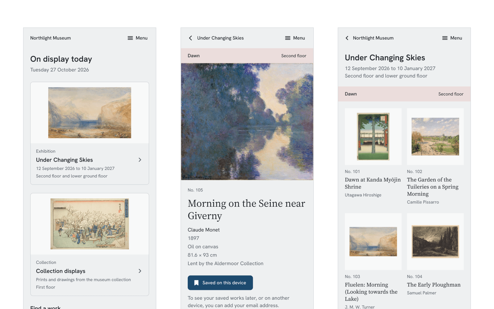
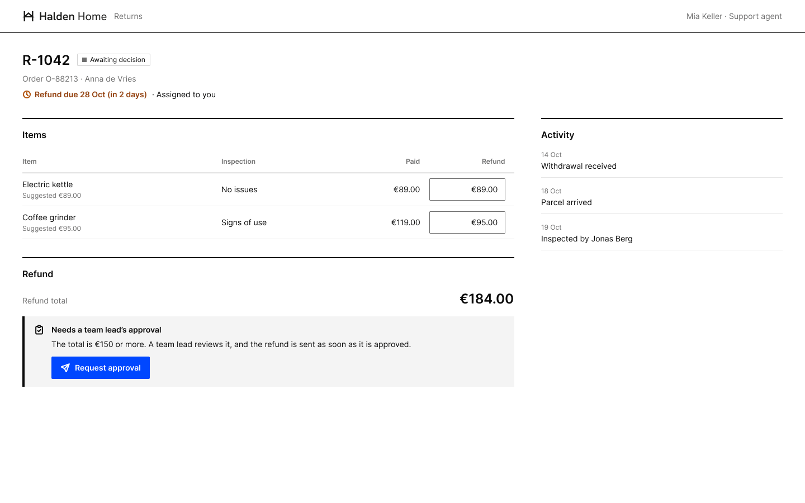
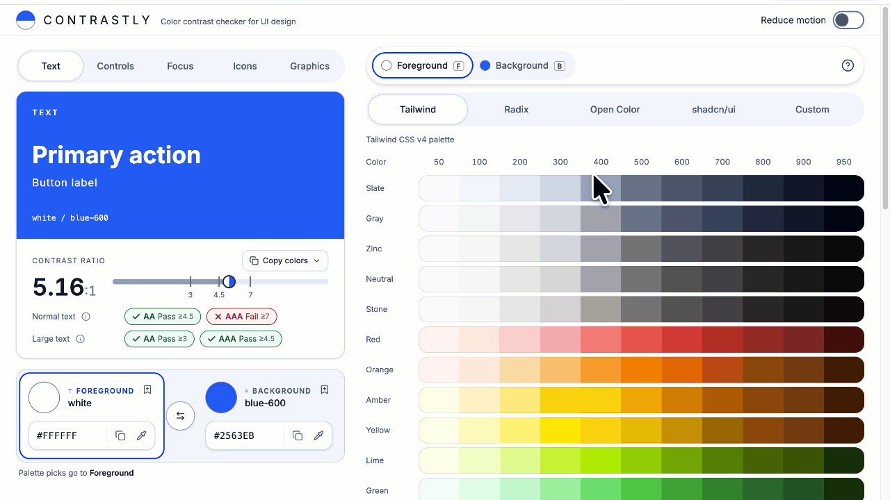

# Hi, I'm Yoko — Software Engineer, specialising in UX architecture 👋

**I define how a product behaves, then build it with TypeScript, React and Next.js.**

I'm a software engineer specialising in UX architecture. I work out how a product behaves in use: what happens after an action, where data goes, which side validates what, and how someone understands an error and recovers. Then I build it, from working prototypes to production code.

My engineering experience includes leading the architecture and implementation of a learning platform MVP in Next.js and TypeScript as the only engineer building its interfaces, developing financial SaaS products, and working on game code and internal developer tools. On a recent energy operations dashboard, part of my prototype code was reused in production.

I use AI coding tools in my everyday work and check what they suggest against the actual code and the specification.

## Focus areas

- **Applications in TypeScript, React and Next.js:** features, reusable components and data handling, from prototype to production.
- **Product behaviour:** interactions, UI states, validation, error handling and recovery flows.
- **Data flows and API agreements:** working with back-end engineers on data contracts and on which side is responsible for what.
- **Accessibility in the codebase:** semantic HTML, ARIA, keyboard interaction, focus behaviour and screen-reader support, with automated and manual checks.
- **Specifications and code review:** documenting decisions and their reasoning, and checking the working product against the agreed behaviour.

---

## Main projects

### Daily Shift Upload — from specification to working dashboard

One workflow, three connected representations: an interactive specification, Figma designs, and a working Next.js dashboard.

The implementation shows how validation rules, UI states, feedback and recovery decisions carry through from specification to working code.

**Stack:** Next.js / TypeScript / Tailwind CSS / Radix UI

- [Live demo](https://ux-sample-dashboard.solastudio.studio/)
- [Interactive specification](https://ux.solastudio.studio/shift-upload-sample)
- [Figma design](https://www.figma.com/design/mLdmFMaurH8tFL0VwA6TuK/Linden-Bakery---Caf%C3%A9---Staff-Schedule-Dashboard?node-id=0-1)
- [Source code](https://github.com/yokoworks/ux-sample-dashboard)

---

### Museum Mobile Guide — screen and API specification (concept)

A screen and API specification for the mobile web guide of a fictional museum. Visitors open the guide via a QR code to find artworks, read or listen to content, and save works without creating an account.

The specification covers offline access to loaded content, saving and synchronisation, past visits that retain the display arrangements of their dates, and artwork images that can no longer be shown after their permitted period. Includes 44 Figma screens across seven sections and a draft seven-endpoint API contract.

- [Specification](https://ux.solastudio.studio/museum-guide-sample)
- [Figma design](https://www.figma.com/design/f2oPWX0hIw9fsvD9GT3ubS/Northlight-Museum)

---

### Returns & Refunds — screen and API specification (concept)

A screen and API specification for a fictional online retailer's internal returns and refunds workflow, shared by returns inspectors, support agents and team leads.

The specification covers role-specific queues, handovers, conditional approvals, delayed payment-provider results, and work left after a refund. Includes 11 Figma screen states, a 13-state return model and a draft five-endpoint API contract.

- [Specification](https://ux.solastudio.studio/returns-sample)
- [Figma design](https://www.figma.com/design/DZUL2eR5fbadtdTwnLrrrY/Halden-Home-Refund-Dashboard?node-id=9-2&t=ZbKuHw7Ys8sGDGBl-1)

---

### Contrastly — colour contrast and design token tool

A colour contrast tool supporting Tailwind CSS, Radix Colors, Open Color, shadcn/ui themes and custom palettes. Preview colour combinations in real UI contexts, check WCAG contrast instantly, and import or export design tokens.

For a playful touch, Liquid Colour Transfer animates a drop of colour travelling from the palette into the preview, spreading and settling with a gentle wobble.

Built with accessible keyboard interactions, screen reader feedback and reduced-motion support. Tested with Playwright, axe-core and VoiceOver.

**Stack:** Next.js / TypeScript / Tailwind CSS / Radix UI / shadcn/ui

- [Open app](https://contrastly.solastudio.studio/)

---

## Writing

- [From Universal Design to Personalized Interfaces](https://medium.com/design-bootcamp/from-universal-design-to-personalized-interfaces-rethinking-accessibility-3f0d9b31150b?sharedUserId=yokoworks)  
  Featured in Bootcamp / UX Collective

- [A Quiet Shift — How Emotional Insight Became My First UX Lesson](https://medium.com/design-bootcamp/a-quiet-shift-how-emotional-insight-became-my-first-ux-lesson-d1a654bc7490?sharedUserId=yokoworks)  
  Featured in Bootcamp / UX Collective and selected for Boost

---

## Links

- [Portfolio](https://ux.solastudio.studio/)
- [LinkedIn](https://www.linkedin.com/in/yokoworks/)
- [Medium](https://medium.com/@yokoworks)
