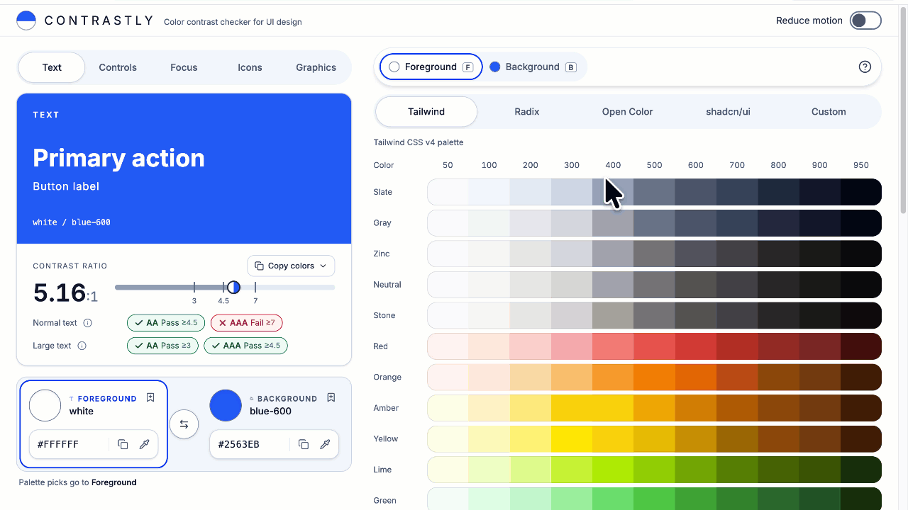

# Hi, I'm Yoko — UX Architect & Frontend Engineer 👋

**Product behaviour, data flows & implementation-ready specifications.**  
**Frontend architecture and implementation with React, Next.js and TypeScript.**

I settle the decisions that otherwise get made inside the code — and I also build and ship web applications.

I work through how a product should behave: what happens after an action, where data goes, which side validates what, and how someone understands and recovers from an error. I make unresolved requirements concrete, work through alternatives with the people responsible, and turn agreements into specifications engineers can build from.

My hands-on engineering experience includes leading frontend architecture and implementation as the sole frontend engineer on a React and Next.js product, developing financial SaaS interfaces, and refactoring legacy game code.

When behaviour is difficult to judge on paper, I test it in a working prototype. My engineering background lets me carry decisions through to working code, whether I am writing the implementation or reviewing it with a team.

## Focus areas

- **Product behaviour:** interactions, UI states, validation, error handling and recovery flows.
- **Data flows and API agreements:** working with backend engineers to define data contracts and frontend/backend responsibilities.
- **Frontend architecture and implementation:** applications, reusable components and product interfaces in React, Next.js and TypeScript.
- **Accessibility in the codebase:** semantic HTML, ARIA, keyboard interaction, focus behaviour and screen-reader support, with automated and manual checks.
- **Specifications and implementation review:** documenting decisions and their reasoning, checking the working product against agreed behaviour, and resolving issues in code.

## Selected experience

### Energy operations dashboard

Carried UX architecture for operating-plan management and mode switching from operational interviews through specifications, backend coordination and vendor implementation review to production. Defined interactions, data flows, validation boundaries and error-code mappings to English and Japanese messages. Provided sample code and directly corrected implementation issues. Both feature areas are in operational use.

### Web3 learning platform

Led frontend architecture and implementation from the initial MVP as the sole frontend engineer. Built the flow from wallet login to certificate issuance, including failed transactions, network mismatches and recovery after interruption. Co-designed API contracts and data flows with the backend engineer, and implemented authentication, user-facing interfaces and admin screens.

More background and case-study detail: [UX Architect Portfolio](https://ux.solastudio.studio/) · [LinkedIn](https://www.linkedin.com/in/yokoworks/)

---

## Main projects

### Contrastly — Open-source Tailwind Color Contrast Checker

A lightweight open-source colour contrast checker for Tailwind CSS palettes, custom hex values and semantic colour token decisions.

Built for frontend developers, designers and anyone who needs to check contrast quickly while working on UI. Includes one-click colour selection, keyboard interaction and reduced-motion support, with automated and manual accessibility checks.

I built it as a practical tool, then cleaned it up and released it as open source through Sola Studio.

**Stack:** Next.js / TypeScript / Tailwind CSS / Radix UI / shadcn/ui / Playwright with Axe

- [Open app](https://contrastly.solastudio.studio/)
- [Source code](https://github.com/yokoworks/contrastly)

---

### Promotee — Interview Flashcard App

A CSV-based interview practice app for practising answers out loud and reviewing prompts.

I built and shipped it with accessibility considered from the start, implementing and validating semantic structure, keyboard interaction, focus behaviour, screen-reader support and colour contrast.

**Stack:** Next.js / TypeScript / Tailwind CSS / Zustand / Radix UI / shadcn/ui

- [Try the app](https://www.promotee.app/)
- [Read the story on Medium](https://javascript.plainenglish.io/what-building-my-first-a11y-focused-app-taught-me-7a2811de2fb1)

---

## Writing

- [From Universal Design to Personalized Interfaces](https://medium.com/design-bootcamp/from-universal-design-to-personalized-interfaces-rethinking-accessibility-3f0d9b31150b?sharedUserId=yokoworks)  
  Featured in Bootcamp / UX Collective

- [The UX Lesson I Learned in a Quiet Tokyo Salon](https://medium.com/design-bootcamp/a-quiet-shift-how-emotional-insight-became-my-first-ux-lesson-d1a654bc7490?sharedUserId=yokoworks)  
  Featured in Bootcamp / UX Collective and selected for Boost

---

## Links

- [UX Architect Portfolio](https://ux.solastudio.studio/)
- [LinkedIn](https://www.linkedin.com/in/yokoworks/)
- [Medium](https://medium.com/@yokoworks)
- [Sola Studio](https://solastudio.studio)
- [Sola Journal](https://www.solajournal.org)
